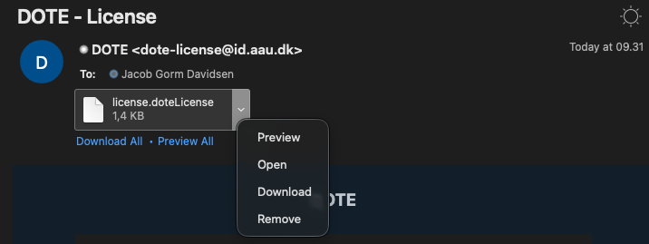

## Installer DOTE og Aktiver DOTE licens {.page_break_before}

### Hent DOTE

Du finder en opdateret version af DOTE på [www.dote.aau.dk](http://www.dote.aau.dk) – download den version som passer til dit operativsystem (Mac/Windows). Du skal trykke på den grønne knap i toppen til højre [”Downloads”]{.mark}.

### DOTE PRO – gratis licens

Studerende på Aalborg Universitet får en gratis licens til DOTE – du skal bruge dette link og registre dig: <https://www.dote.aau.dk/license-details/3> - det er vigtigt, at du bruger din AAU-student mail.

Ansatte på SSH får samme behandling, så de kan også hente en gratis PRO licens.

Er du ikke studerende på AAU, så må du i sparegrisen eller få din skole overbevist om at købe en licens til dig og dine studiekammerater.

### Installer DOTE

Når du har hentet installationsfilen – så skal DOTE installeres. Det foregår som du plejer, når du har hentet software på nettet.

Windows: klik to gange på dote.exe – så starter installationsprocessen. Du støder nok en advarsel ala nedenstående

{#fig:windows-advarsel width="40%"}

{#fig:windows-run-anyway width="40%"}

Men du klikker hurtigt på More info. Så får du mulighed for at vælge ”Run Anyways”. Så bliver DOTE installeret.

Mac: træk DOTE over i din Applications mappe. Din Mac kan også brokke sig lidt. For at installere DOTE på din Mac skal du nok op ”System præferencer”, vælge ”Sikkerhed og privatliv”, vælg ”General”, så skulle du gerne se en mulighed for at installere DOTE alligevel. Det kan se lidt forskelligt ud fra OS version til OS version. Men det er altså cirka her du finder det.

Når du er færdig, så er du klar til at gå i gang med dit første projekt. [Men bliv lige her og læs den næste sektion]{.underline}, så du kan få aktiveret din licens med det samme.

### Aktiver licens

Nu har du hentet og installeret DOTE. Som studerende på Aalborg Universitet, så har du også skrevet dig op til en gratis version af DOTE. Så nu åbner du lige din AAU mail. Du har modtaget en mail fra DOTE. Her finder du en vedhæftet fil license.DOTElicense – du downloader denne fil (højreklik på filen eller dobbelt tap (mac). [Og stop – du kan ikke åbne denne fil ved at klikke på den]{.underline}.

{#fig:licens-mail width="80%"}

Det er en licensnøgle, som skal aktiveres i DOTE. Så åbner du DOTE, hvis du ikke allerede har gjort det. Så følger du disse skridt:

1.  Klik på “Help og vælg License Manager”
2.  Klip på “Add license key from file” og lokaliser license.DOTElicense (den er i dine overførsler eller der hvor du normalt gemmer dine downloads)
3.  Klik på “Activate license”

Sådan nu er du klar til at transskribere med DOTE Pro.
