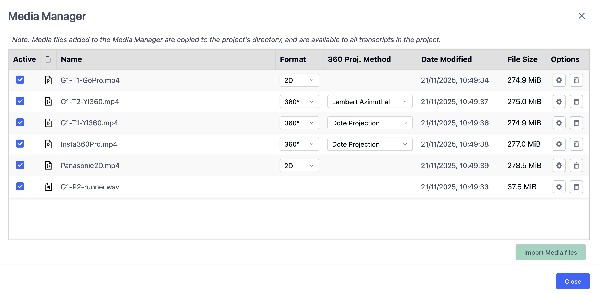
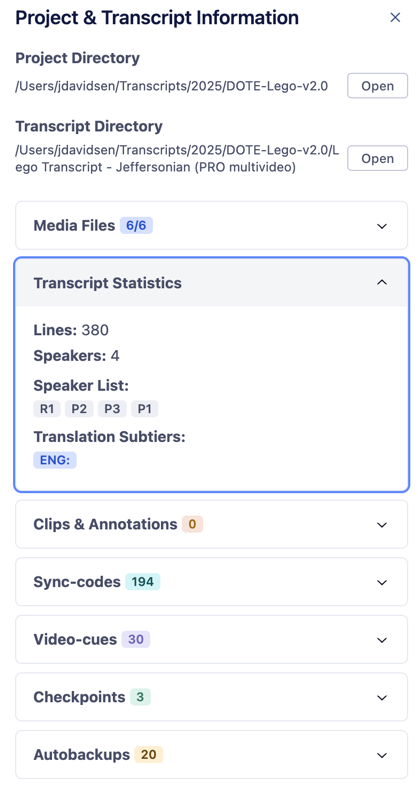

## DOTE interface – top bjælken {.page_break_before}

Lad os se lidt nærmere på interfacet. DOTE er opbygget af fleksible paneler, som du kan placere, minimere og maksimere som du har lyst til. Denne del af quickguide fokuserer kun på den øverste del af interfacet.

{#fig:paneler-og-layout}

### 1. Paneler og layout

Under låge nummer 1 gemmer sig ”Panels and Layouts”. Her kan du tilpasse og justere dit layout og åbne flere paneler, hvis du ønsker flere ”Timeline waveform” eller ”Media Player. Du kan være mellem forskellige layout modes og ”Panel actions” (se nedenfor). Når du har tilpasset og justeret DOTE layout til lige præcis dit behov – så kan du gemme det til senere. Det kan være særlig relevant, hvis du har forskellige arbejdssteder. Deruover har vi gemt nogle standard layouts som du nemt og hurtigt kan skifte i mellem.

Når du åbner DOTE første gang, så du i ”Full mode” – se under ”Panel actions”. Det er smart nok indtil du har lært DOTE godt at kende – så kan du gå i ”Zen mode”. Du kan skifte lidt i mellem de forskllige modes and actions for at finde det rette layout for dig.

Så DOTE kan sættes op på den måde du bedst kan lide. Det enkelte panel kan flyttes rundt, gøres større eller mindre. Nogle paneler kan du også have flere af fx flere kameravinkler. Til højre for ”Panels and Layout” kan du låse panel positionerne, så du ikke ved et tilfælde kommer til at flytte rundt på dem.

### 2. Projekt manager

Her finder du dine projekter – jo mere du bruger DOTE jo flere projekter vil du have. Du kan se forskellige status for dit projekt og din transskription. Du kan også tilføje transskriptioner som bogmærker (bookmarks), så de er lettere at finde en anden gang. DOTE er smart, så hvis du har nogle DOTE projekter i en mappe, så finder vi det til dig. Det er også muligt at oprette en ny transskription direkte fra dette vindue.

{#fig:projekt-manager}

### 3. Media manager

Når du har oprettet et projekt er Media Manager et af de første steder du skal hen. I Media Manager tilføjer du lyd eller videofiler til dit projekt. DOTE kan også afspille 360-graders videoer. Husk at klikke af i Active for at du kan se og afspille videoerne i dit projekt. Du kan også regenerer waveformen ved at klikke på tandhjulet.

{#fig:media-manager}

### 4. Undo/redo manager

Ja, det giver lidt sig selv. Du kan fortryde og du kan fortryde igen. Men DOTE2.0 udvider lige de gængse forståelser af redo/undo ved at tilføje en decideres manager, som kan spole frem og tilbage i dine handlinger.

{#fig:undo-redo-manager}

### 5. Checkpoints and autobackups

Kender du det? Du har lige mistet en dags arbejde. Det er træls. DOTE har to funktioner til at gemme dit arbejde – og det bedste er at du altid kan vende tilbage til en tidligere version af dit arbejde. Autobackups tager selvfølgelig en kopi af dit arbejde med et vist interval. Checkpoints er derimod din mulighed for at gemme og kommenterer på dit arbejde. Du kan bruge det til at huske dig selv på, hvad du arbejdede med i dag eller bruge det som kommentarer til dine samarbejdspartnere, når de skal overtage arbejdet. Smart.

### 6. Import/export

Alle funktioner som relatere sig til import af andre filer eller projekter foregår ved Import. Skal eksportere dit projekt eller din transskription så klikker du på Export.

### 7. project Info

{#fig:project-info width="30%"}

Her finder de mest basale informationer om dit projekt. Til en start står der ikke meget. Men i takt med at du arbejder på dit projekt, så fylder DOTE automatisk informationerne ud. Du kan se mange spændende ting her. Du kan se hvilke medier fuler som er tilknyttet projektet, statistik om din transskription, antallet af clips og annotationer, antal af sync-codes og video-cues og dine checkpoints og autobackups. Med project info kan du hurtigt få et overblik over dit projekt.

### 8. DOTE settings

Her kan du foretage alle mulige former for tilpasninger af DOTE. Du skal ikke blive skræmt, der er virkelig mange indstillinger. Nogle er relevant for dig, hvor andre indstillinger er mere relevante for andre. Du kan blandt andet indstille hvor ofte DOTE skal lave en autoback, ændre shortcuts og ændre grundlæggende indstillinger for DOTE.
