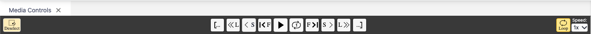
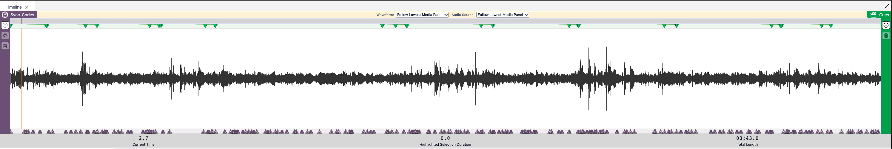

## Interface – de forskellige paneler {.page_break_before}

Lad os se lidt nærmere på de forskellige paneler. Vi gennemgår dem en for en i og med at du kan tilpasse de forskellige paneler til dine behov har vi ikke inkluderet et screenshot.

### Medieafspiller

Du kan sidde og klikke med din mus på de forskellige knapper – spild af tid. Du vil opleve at du kan få lavet meget mere arbejde ved at bruge nogle få shortcuts.

{#fig:medieafspiller}

Derfor har jeg kun fokus på genveje på dit keyboard:

- Afspil lyd/video = CTRL+SPACE \[⌘+N\].
- Afspil video og vend tilbage til start position (super fed funktion) = CTRL+SHIFT+SPACE \[⌘+⇧+N\]
- Hop lidt tilbage= CTRL+J \[⌘+J\]
- Hop lidt frem = CTRL+K \[⌘+K\].
- Hop lidt mere frem og tilbage= Hold SHIFT or ⇧ nede for større hop
  - CTRL+J/⌘+J = 1 sekund tilbage
  - CTRL+SHIFT+J/⌘+⇧+J = 4 sekunder tilbage
  - CTRL+K/⌘+K = 1 sekund frem
  - CTRL+SHIFT+K/⌘+⇧+K = 4 sekunder frem
- To step forward or backwards by one frame (may skip a frame)
  - CTRL+ALT+J or \[⌘+⌥+J\] = 1 frame tilbage
  - CTRL+ALT+K or \[⌘+⌥+K\] = 1 frame frem

Du er nødt til at bruge touchpad til at styre hastigheden – det er i højre side – vælg din ønskede hastighed under ”speed”.

### Waveform

Her ser vi en visual repræsentation af lydkilden. Kvaliteten afhænger meget lyden du har optaget (type af mikrofon, fil-format, etc.). Du kan zoome ind og ud på waveformen. Du kan se den nuværende position for video, den samlede længde og hvor lang tid et udvalgt segment er. Du kan bruge du lilla (sync-codes) og grønne (video-cues) trekant til at navigere rundt i din video. Vi ser på hvordan du tilføjer sync-codes og video cues senere i guiden.

{#fig:waveform}

Hvis du ikke vil se sync-codes eller video-cues så kan du bare klikke på knappen ”sync-codes” eller ”cues”.

### Transskription

Så er vi kommet til transskriptionseditoren. Her skriver du din transskription eller redigerer i en transskription andre har lavet (inkl. AI baserede transskriptioner). Det ligner lidt et helt almindelig word-dokument, men lad dig ikke narre. DOTE er bygget til at understøtte transskribering – intet andet. Her under ser du et billede af editoren

{#fig:transskriptionseditor}

Øverst finder du forskellige grupperinger af funktioner:

- Sync codes – alt hvad der drejer sig om tid
  - Slå til/fra: DOTE synkronisere afspilning af transskriptionen med mediefilen.
  - Tilføj standard sync code på den linje din cursor er placeret på.
  - Tilføj ranged sync code – du skal have markeret et segment
  - Slet sync-code
- Annotations – kommentarer til transskription
  - Vis/skjul transcript-clips
  - Tilføj et transcript-clip
  - Slet et transcript-clip
- Search and replace
  - Søgfunktion
  - Erstatfunktion
- Formatering – det siger sig selv
  - Du kan lave understregninger af ord eller enkelte bogstaver
- Display – DOTE giver dig feedback på din transskription
  - Vis/skjul warnings i din transskription
  - Vis/sjul fejl i din transkription
- Options
  - Her kan du tilpasse indstillingerne for den enkelte transskription
