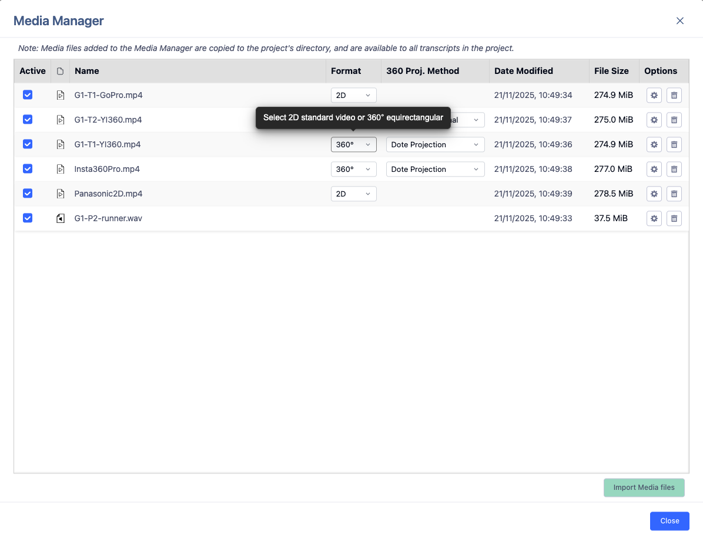

## Start nyt projekt {.page_break_before}

For at komme i gang med at nyt projekt, så skal du vælge File → New project. Så åbner et vindue, hvor du skal angive hvor projektet skal gemmes på din computer (vælg et sted, som ikke er koblet med en cloud service (Onedrive, Icloud, dropbox, etc.). Så giver du dit nye projekt et navn og lad os også give transskriptionen et navn. Vi vælger Jefferson som standard.

{#fig:nyt-projekt}

### Importer mediefiler

Så har du lavet et projekt med en tilhørende transskription. Nu skal vi have tilknyttet de lyd- eller video-optagelser du skal arbejde med. I toppen af DOTE finder du ”Media Manager” – klik på den. Her kan du importere medie filer ind i dit projekt (obs. DOTE laver en kopi af din mediefil, så vær opmærksom på plads). Du trykker på Import Media Files og lokalisere den eller de filer du vil arbejde med. Afhængig af størrelsen på filen kan det tage lidt tid. Vær opmærksom på om der er flueben ud for den eller de filer du vil arbejde med.

{#fig:importer-mediefiler}

### Start ny transkription

#### Vælg Jefferson som standard

Jefferson, hva for noget! Du kan bruge DOTE uden nogen form for transskriptionskonvention – så skriver du bare løs. Men hvis du vil udnytte DOTEs fulde potentiale, så skal du i gang med Jefferson (eller Mondada). Vi fokuserer udelukkende på Jefferson her, hvis du vil prøve Mondadas konventioner så se vores tuturial om det online.

#### Metatekst

I toppen af transskriptionen I DOTE er det en god ide med lidt info. I DOTE skriver vi denne type info ved at bruge to // - så bliver teksten blå og DOTE ved at det er metatekst. Det er vigtigt, når vi skal eksportere vores transskription senere. Og det sådan set også fedt nok at vide hvad transskriptionen handler om – også hvis man skal sende ens transskription til andre I ens projektgruppe.

{#fig:metatekst}

#### Initialer : tabs

For at DOTE kan hjælpe dig bedst muligt, så skal du simpelten følge denne struktur initialer: Tabs. Det ser sådan ud:

{#fig:initialer-tabs}

Hvis ikke teksten bliver grøn, så har du lavet en fejl fx brugt space i stedet for tabs. Det går ikke → se linje 14.

#### Transkriber

Så er det bare med at komme i gang. DOTE tilføjer automatisk linjenumre til hver linje, så det skal du ikke tænke på. Du skal derimod bare skrive det du kan høre (og se) og følge Jeffersons konventioner. Jamen hovsa – DOTE kan hjælpe dig med at følge Jeffersons konventioner. Kan du fx huske genvejstasten til gradetegn? Nej, vel. DOTE kan hjælpe dig – bare skriv s – så kommer DOTE med et forslag.

{#fig:jefferson-forslag}

Så har du brugt det rigtige tegn til at vise at ord/sætninger bliver sagt hviskende eller lavt. DOTE hjælper dig med mange andre symboler og tegn, så du kan følge Jefferson.
