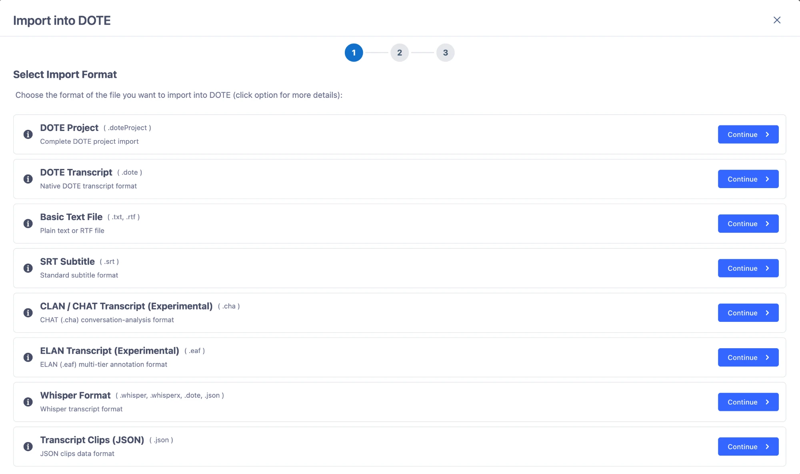

## Importer {.page_break_before}

Du har modtaget en transskription fra en studiekammerat eller en AI. What to do?

Du klikker på ”Import” i top bjælken. Så åbner ”Import into DOTE”, som guider dig igennem importen i tre trin. I første trin vælger du, hvilket format filen har – og så klikker du på ”Continue” ud for det rigtige format. Er du i tvivl, så klik på det lille i'et ud for formatet, så får du flere detaljer.

{#fig:import-format}

### DOTE Project og DOTE Transcript

Som studerende er det især de to første formater du får brug for:

- **DOTE Project (.doteProject)** – et helt DOTE-projekt med det hele. Det er det du skal vælge, når en fra din projektgruppe sender dig sit projekt, eller når du vil åbne et projekt du selv har eksporteret, fx fra en anden computer.
- **DOTE Transcript (.dote)** – en enkelt transskription i DOTEs eget format. Det er det du skal vælge, når en studiekammerat sender dig den del af transskriptionen, som vedkommende har lavet. Når transskriptionen er importeret i dit projekt, så kan du merge jeres transskriptioner sammen (se afsnittet om at samarbejde og merge transskriptioner).

### Andre formater

DOTE kan også importere en række andre formater:

| Format | Filtype | Hvornår? |
|---|---|---|
| Basic Text File | .txt, .rtf | Almindelig tekst eller en rtf-fil, fx fra Word |
| SRT Subtitle | .srt | Undertekstfiler – fx fra et automatisk transskriptionsværktøj |
| CLAN / CHAT Transcript (Experimental) | .cha | Transskriptioner fra CLAN |
| ELAN Transcript (Experimental) | .eaf | Annotationer fra ELAN |
| Whisper Format | .whisper, .whisperx, .dote, .json | AI-transskriptioner fra Whisper |
| Transcript Clips (JSON) | .json | Transcript-clips (annotationer) |

Formater markeret med *Experimental* er stadig under udvikling – så tjek din transskription grundigt efter importen.

## Eksporter

I DOTE kan du nemt eksportere dit arbejde.

### Eksporter projekt eller transkriptioner

### Eksporter transskriptioner til word

De fleste studerende arbejder med mindre udsnit af deres grov transskriptioner i deres projektrapporter. Derfor kan du med DOTE eksportere din transskription til rtf (en fil der kan læses af Word). Du kan vælge at eksportere hele din transskription eller specifikke dele. Lad os se hvordan.
