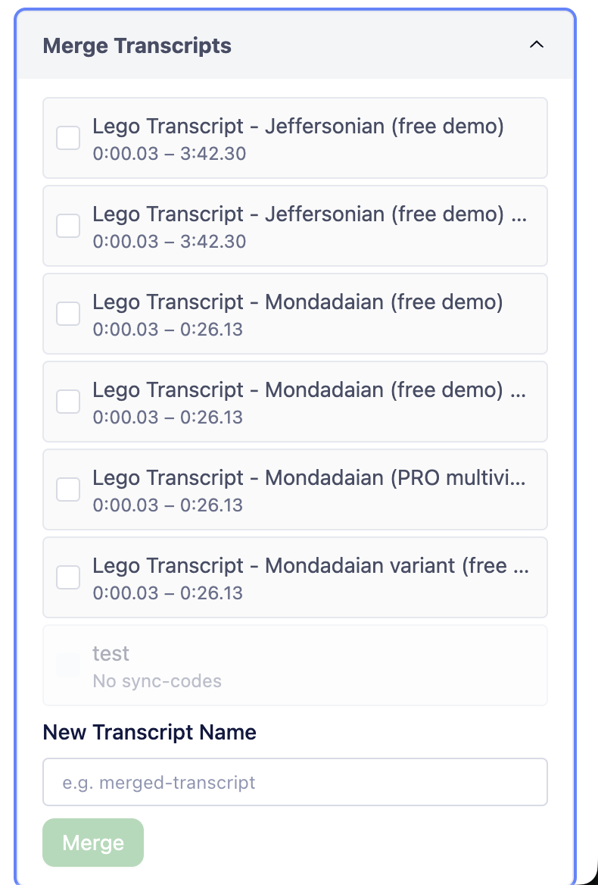

## Samarbejd og merge transskriptioner {.page_break_before}

Transskribering tager tid – og det går hurtigere, når I er flere om det. Med DOTE kan du samarbejde med andre om en transskription: I deler optagelsen op, transskriberer hver jeres del, og bagefter merger I jeres transskriptioner sammen til én samlet transskription. Det kan du gøre i den nyeste version af DOTE.

### Del arbejdet op

Inden I går i gang, så aftal hvem der transskriberer hvilken del af optagelsen – fx at du tager de første 15 minutter, og din studiekammerat tager resten. Hver af jer laver jeres egen transskription i DOTE, og I husker at sætte sync-codes i jeres transskription undervejs.

### Merge transskriptionerne

Når I er færdige, så samler du transskriptionerne i samme projekt. ”Merge Transcripts” gemmer sig under ”Project info” i top bjælken (nummer 7). Her ser du alle transskriptioner i projektet og hvilket tidsrum de dækker (fra første til sidste sync-code).

{#fig:merge-transcripts width="45%"}

1.  Sæt flueben ud for de transskriptioner, du vil merge.
2.  Giv den nye transskription et navn under ”New Transcript Name”.
3.  Klik på ”Merge”.

DOTE laver så en ny transskription, hvor jeres dele er sat sammen i rækkefølge efter sync-codes.

### Pas på dine sync-codes

Det er sync-codes der styrer, hvordan DOTE sætter transskriptionerne sammen. Derfor er det vigtigt at være opmærksom på to ting:

- **Sync-codes må ikke overlappe hinanden.** Hvis din del går fra 0:00 til 15:00, så skal din studiekammerats del starte efter 15:00. Overlapper tidsrummene, så kan DOTE ikke vide, hvilken linje der kommer først.
- **En transskription uden sync-codes kan ikke merges.** Den bliver vist med gråt og teksten ”No sync-codes” – som ”test” i @fig:merge-transcripts. Tilføj sync-codes til den, før du prøver igen.
