---
title: Quickguide til DOTE 2.0
keywords:
- DOTE
- transskription
- konversationsanalyse
- Jefferson
- quickguide
lang: da-DK
date-meta: '2026-10-16'
author-meta:
- Jacob Gorm Davidsen
header-includes: |
  <!--
  Manubot generated metadata rendered from header-includes-template.html.
  Suggest improvements at https://github.com/manubot/manubot/blob/main/manubot/process/header-includes-template.html
  -->
  <meta name="dc.format" content="text/html" />
  <meta property="og:type" content="article" />
  <meta name="dc.title" content="Quickguide til DOTE 2.0" />
  <meta name="citation_title" content="Quickguide til DOTE 2.0" />
  <meta property="og:title" content="Quickguide til DOTE 2.0" />
  <meta property="twitter:title" content="Quickguide til DOTE 2.0" />
  <meta name="dc.date" content="2026-10-16" />
  <meta name="citation_publication_date" content="2026-10-16" />
  <meta property="article:published_time" content="2026-10-16" />
  <meta name="dc.modified" content="2026-10-16T11:14:54+00:00" />
  <meta property="article:modified_time" content="2026-10-16T11:14:54+00:00" />
  <meta name="dc.language" content="da-DK" />
  <meta name="citation_language" content="da-DK" />
  <meta name="dc.relation.ispartof" content="Manubot" />
  <meta name="dc.publisher" content="Manubot" />
  <meta name="citation_journal_title" content="Manubot" />
  <meta name="citation_technical_report_institution" content="Manubot" />
  <meta name="citation_author" content="Jacob Gorm Davidsen" />
  <meta name="citation_author_institution" content="Institut for Kultur og Kommunikation, Aalborg Universitet" />
  <meta name="citation_author_orcid" content="0000-0002-5240-9452" />
  <link rel="canonical" href="https://codeslayer84.github.io/DOTEQUICK/" />
  <meta property="og:url" content="https://codeslayer84.github.io/DOTEQUICK/" />
  <meta property="twitter:url" content="https://codeslayer84.github.io/DOTEQUICK/" />
  <meta name="citation_fulltext_html_url" content="https://codeslayer84.github.io/DOTEQUICK/" />
  <meta name="citation_pdf_url" content="https://codeslayer84.github.io/DOTEQUICK/manuscript.pdf" />
  <link rel="alternate" type="application/pdf" href="https://codeslayer84.github.io/DOTEQUICK/manuscript.pdf" />
  <link rel="alternate" type="text/html" href="https://codeslayer84.github.io/DOTEQUICK/v/585033cc4b460bc8987901ac210a2452ee309cf9/" />
  <meta name="manubot_html_url_versioned" content="https://codeslayer84.github.io/DOTEQUICK/v/585033cc4b460bc8987901ac210a2452ee309cf9/" />
  <meta name="manubot_pdf_url_versioned" content="https://codeslayer84.github.io/DOTEQUICK/v/585033cc4b460bc8987901ac210a2452ee309cf9/manuscript.pdf" />
  <meta property="og:type" content="article" />
  <meta property="twitter:card" content="summary_large_image" />
  <link rel="icon" type="image/png" sizes="192x192" href="https://manubot.org/favicon-192x192.png" />
  <link rel="mask-icon" href="https://manubot.org/safari-pinned-tab.svg" color="#ad1457" />
  <meta name="theme-color" content="#ad1457" />
  <!-- end Manubot generated metadata -->
bibliography:
- content/manual-references.json
manubot-output-bibliography: output/references.json
manubot-output-citekeys: output/citations.tsv
manubot-requests-cache-path: ci/cache/requests-cache
manubot-clear-requests-cache: false
...

<small><em>
This manuscript
([permalink](https://codeslayer84.github.io/DOTEQUICK/v/585033cc4b460bc8987901ac210a2452ee309cf9/))
was automatically generated
from [codeslayer84/DOTEQUICK@585033c](https://github.com/codeslayer84/DOTEQUICK/tree/585033cc4b460bc8987901ac210a2452ee309cf9)
on October 16, 2026.
</em></small>

## Forfattere

+ **Jacob Gorm Davidsen**
  ^[✉](#correspondence)^ 
    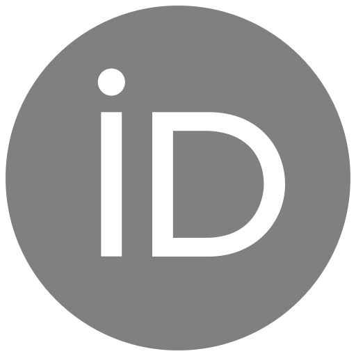{.inline_icon width=16 height=16}
    [0000-0002-5240-9452](https://orcid.org/0000-0002-5240-9452)
    · 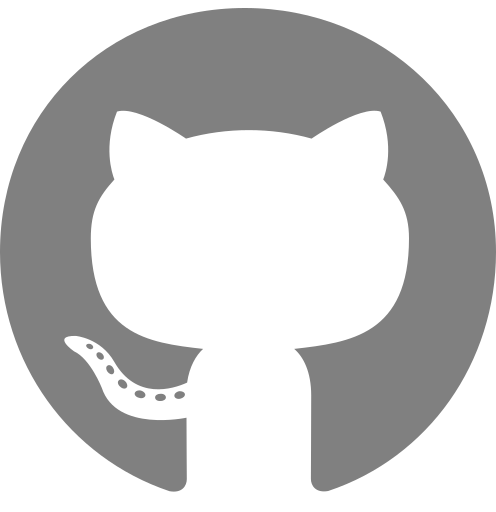{.inline_icon width=16 height=16}
    [codeslayer84](https://github.com/codeslayer84)
     
  <small>
     Institut for Kultur og Kommunikation, Aalborg Universitet
  </small>

::: {#correspondence}
✉ — Correspondence possible via [GitHub Issues](https://github.com/codeslayer84/DOTEQUICK/issues)
or email to
Jacob Gorm Davidsen \<jdavidsen@ikk.aau.dk\>.

:::

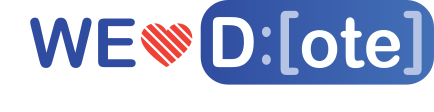{width="45%"}

Featuring @ © Bigsoftvideo

## Forord {.page_break_before}

Velkommen til DOTE2.0!

Du kan altid finde den nyeste udgave af DOTE på [www.dote.aau.dk](http://www.dote.aau.dk) og som studerende på Aalborg Universitet har du gratis adgang til Pro versionen. DOTE er gratis for dig – så citer DOTE eller give vores tutorials på [Youtube](https://www.youtube.com/playlist?list=PLQJhL9BD4W1QD1AD1gGCcOXSUbwu_iNT1) et like/subscribe.

Du kan også bruge DOTE (free version), men så får du altså ikke den fulde pakke. Tag fat på din it-afdeling og få dem til at købe licenser til jer eller sving dit eget dankort.

Dette er en quickguide som skal hjælpe dig i gang med DOTE – vi kommer ikke omkring alt i denne guide. Men du kan finde de fleste svar i vores [help-guide](https://bigsoftvideo.github.io/DOTE/) eller se vores [tutorials](https://www.youtube.com/channel/UCa630YAfmxMbdra20BIW0xA) på Youtube.

Hvis du har en meget gammel computer fx en Mac fra din konfirmation, så kan DOTE være lidt langsom. Og ja, denne tekst er ikke skrevet som en akademisk videnskabelig artikel, men som en formidlende informativ tekst med det formål at give dig lidt støtte i dit møde med DOTE.

Det er dit eget ansvar at opbevare indsamlet data (lyd- og video-filer) et sikkert sted, men DOTE behandler **ikke** dit data.

Har du forslag til forbedringer af denne quickguide – så kan du blive medredaktør ved at sende en mail til <jdavidsen@ikk.aau.dk> – du skal ikke betragte guiden som færdig, da vi hele tiden udvikler på DOTE – guiden er *permanent beta!*

God arbejdslyst.

Jacob Davidsen

Citer DOTE [@raw:dote]:

> McIlvenny, Paul (Producer), Davidsen, Jacob Gorm (Producer), Kovács, Artúr Barnabás (Developer), & Stein, Alexander (Developer). (2022/6). DOTE: Distributed Open Transcription Environment. Computer programme, Github. <https://github.com/BigSoftVideo/DOTE/>

## Installer DOTE og Aktiver DOTE licens {.page_break_before}

### Hent DOTE

Du finder en opdateret version af DOTE på [www.dote.aau.dk](http://www.dote.aau.dk) – download den version som passer til dit operativsystem (Mac/Windows). Du skal trykke på den grønne knap i toppen til højre [”Downloads”]{.mark}.

### DOTE PRO – gratis licens

Studerende på Aalborg Universitet får en gratis licens til DOTE – du skal bruge dette link og registre dig: <https://www.dote.aau.dk/license-details/3> - det er vigtigt, at du bruger din AAU-student mail.

Ansatte på SSH får samme behandling, så de kan også hente en gratis PRO licens.

Er du ikke studerende på AAU, så må du i sparegrisen eller få din skole overbevist om at købe en licens til dig og dine studiekammerater.

### Installer DOTE

Når du har hentet installationsfilen – så skal DOTE installeres. Det foregår som du plejer, når du har hentet software på nettet.

Windows: klik to gange på dote.exe – så starter installationsprocessen. Du støder nok en advarsel ala nedenstående

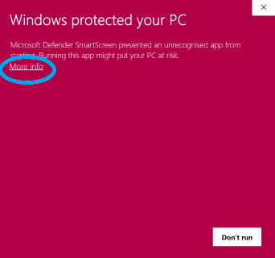{#fig:windows-advarsel width="40%"}

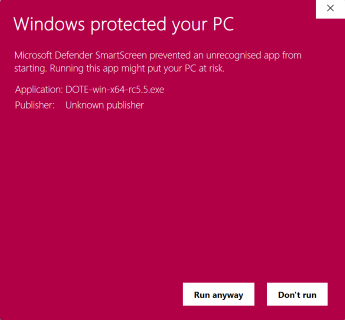{#fig:windows-run-anyway width="40%"}

Men du klikker hurtigt på More info. Så får du mulighed for at vælge ”Run Anyways”. Så bliver DOTE installeret.

Mac: træk DOTE over i din Applications mappe. Din Mac kan også brokke sig lidt. For at installere DOTE på din Mac skal du nok op ”System præferencer”, vælge ”Sikkerhed og privatliv”, vælg ”General”, så skulle du gerne se en mulighed for at installere DOTE alligevel. Det kan se lidt forskelligt ud fra OS version til OS version. Men det er altså cirka her du finder det.

Når du er færdig, så er du klar til at gå i gang med dit første projekt. [Men bliv lige her og læs den næste sektion]{.underline}, så du kan få aktiveret din licens med det samme.

### Aktiver licens

Nu har du hentet og installeret DOTE. Som studerende på Aalborg Universitet, så har du også skrevet dig op til en gratis version af DOTE. Så nu åbner du lige din AAU mail. Du har modtaget en mail fra DOTE. Her finder du en vedhæftet fil license.DOTElicense – du downloader denne fil (højreklik på filen eller dobbelt tap (mac). [Og stop – du kan ikke åbne denne fil ved at klikke på den]{.underline}.

{#fig:licens-mail width="80%"}

Det er en licensnøgle, som skal aktiveres i DOTE. Så åbner du DOTE, hvis du ikke allerede har gjort det. Så følger du disse skridt:

1.  Klik på “Help og vælg License Manager”
2.  Klip på “Add license key from file” og lokaliser license.DOTElicense (den er i dine overførsler eller der hvor du normalt gemmer dine downloads)
3.  Klik på “Activate license”

Sådan nu er du klar til at transskribere med DOTE Pro.

## DOTE interface – top bjælken {.page_break_before}

Lad os se lidt nærmere på interfacet. DOTE er opbygget af fleksible paneler, som du kan placere, minimere og maksimere som du har lyst til. Denne del af quickguide fokuserer kun på den øverste del af interfacet.

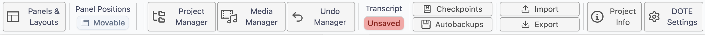{#fig:paneler-og-layout}

### 1. Paneler og layout

Under låge nummer 1 gemmer sig ”Panels and Layouts”. Her kan du tilpasse og justere dit layout og åbne flere paneler, hvis du ønsker flere ”Timeline waveform” eller ”Media Player. Du kan være mellem forskellige layout modes og ”Panel actions” (se nedenfor). Når du har tilpasset og justeret DOTE layout til lige præcis dit behov – så kan du gemme det til senere. Det kan være særlig relevant, hvis du har forskellige arbejdssteder. Deruover har vi gemt nogle standard layouts som du nemt og hurtigt kan skifte i mellem.

Når du åbner DOTE første gang, så du i ”Full mode” – se under ”Panel actions”. Det er smart nok indtil du har lært DOTE godt at kende – så kan du gå i ”Zen mode”. Du kan skifte lidt i mellem de forskllige modes and actions for at finde det rette layout for dig.

Så DOTE kan sættes op på den måde du bedst kan lide. Det enkelte panel kan flyttes rundt, gøres større eller mindre. Nogle paneler kan du også have flere af fx flere kameravinkler. Til højre for ”Panels and Layout” kan du låse panel positionerne, så du ikke ved et tilfælde kommer til at flytte rundt på dem.

### 2. Projekt manager

Her finder du dine projekter – jo mere du bruger DOTE jo flere projekter vil du have. Du kan se forskellige status for dit projekt og din transskription. Du kan også tilføje transskriptioner som bogmærker (bookmarks), så de er lettere at finde en anden gang. DOTE er smart, så hvis du har nogle DOTE projekter i en mappe, så finder vi det til dig. Det er også muligt at oprette en ny transskription direkte fra dette vindue.

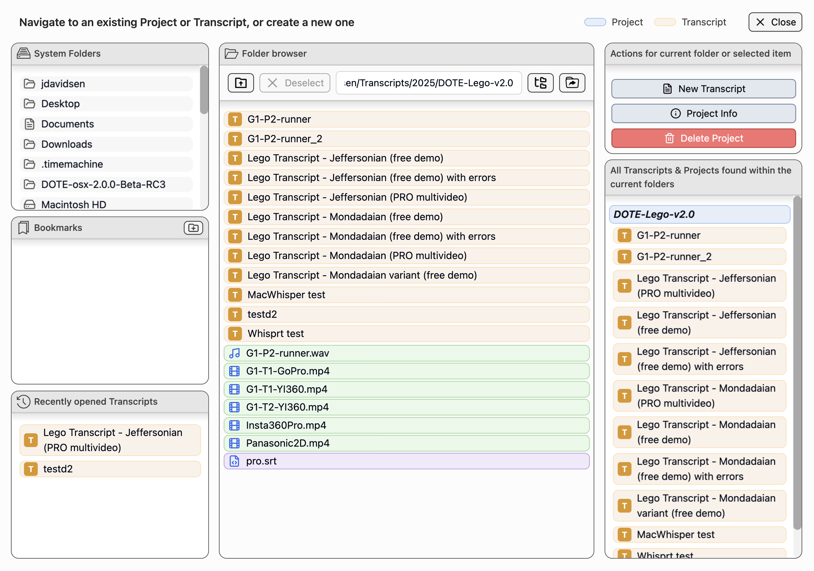{#fig:projekt-manager}

### 3. Media manager

Når du har oprettet et projekt er Media Manager et af de første steder du skal hen. I Media Manager tilføjer du lyd eller videofiler til dit projekt. DOTE kan også afspille 360-graders videoer. Husk at klikke af i Active for at du kan se og afspille videoerne i dit projekt. Du kan også regenerer waveformen ved at klikke på tandhjulet.

{#fig:media-manager}

### 4. Undo/redo manager

Ja, det giver lidt sig selv. Du kan fortryde og du kan fortryde igen. Men DOTE2.0 udvider lige de gængse forståelser af redo/undo ved at tilføje en decideres manager, som kan spole frem og tilbage i dine handlinger.

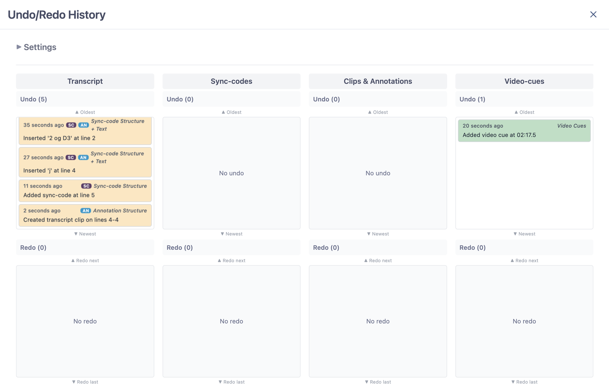{#fig:undo-redo-manager}

### 5. Checkpoints and autobackups

Kender du det? Du har lige mistet en dags arbejde. Det er træls. DOTE har to funktioner til at gemme dit arbejde – og det bedste er at du altid kan vende tilbage til en tidligere version af dit arbejde. Autobackups tager selvfølgelig en kopi af dit arbejde med et vist interval. Checkpoints er derimod din mulighed for at gemme og kommenterer på dit arbejde. Du kan bruge det til at huske dig selv på, hvad du arbejdede med i dag eller bruge det som kommentarer til dine samarbejdspartnere, når de skal overtage arbejdet. Smart.

### 6. Import/export

Alle funktioner som relatere sig til import af andre filer eller projekter foregår ved Import. Skal eksportere dit projekt eller din transskription så klikker du på Export.

### 7. project Info

{#fig:project-info width="30%"}

Her finder de mest basale informationer om dit projekt. Til en start står der ikke meget. Men i takt med at du arbejder på dit projekt, så fylder DOTE automatisk informationerne ud. Du kan se mange spændende ting her. Du kan se hvilke medier fuler som er tilknyttet projektet, statistik om din transskription, antallet af clips og annotationer, antal af sync-codes og video-cues og dine checkpoints og autobackups. Med project info kan du hurtigt få et overblik over dit projekt.

### 8. DOTE settings

Her kan du foretage alle mulige former for tilpasninger af DOTE. Du skal ikke blive skræmt, der er virkelig mange indstillinger. Nogle er relevant for dig, hvor andre indstillinger er mere relevante for andre. Du kan blandt andet indstille hvor ofte DOTE skal lave en autoback, ændre shortcuts og ændre grundlæggende indstillinger for DOTE.

## Interface – de forskellige paneler {.page_break_before}

Lad os se lidt nærmere på de forskellige paneler. Vi gennemgår dem en for en i og med at du kan tilpasse de forskellige paneler til dine behov har vi ikke inkluderet et screenshot.

### Medieafspiller

Du kan sidde og klikke med din mus på de forskellige knapper – spild af tid. Du vil opleve at du kan få lavet meget mere arbejde ved at bruge nogle få shortcuts.

{#fig:medieafspiller}

Derfor har jeg kun fokus på genveje på dit keyboard:

- Afspil lyd/video = CTRL+SPACE \[⌘+N\].
- Afspil video og vend tilbage til start position (super fed funktion) = CTRL+SHIFT+SPACE \[⌘+⇧+N\]
- Hop lidt tilbage= CTRL+J \[⌘+J\]
- Hop lidt frem = CTRL+K \[⌘+K\].
- Hop lidt mere frem og tilbage= Hold SHIFT or ⇧ nede for større hop
  - CTRL+J/⌘+J = 1 sekund tilbage
  - CTRL+SHIFT+J/⌘+⇧+J = 4 sekunder tilbage
  - CTRL+K/⌘+K = 1 sekund frem
  - CTRL+SHIFT+K/⌘+⇧+K = 4 sekunder frem
- To step forward or backwards by one frame (may skip a frame)
  - CTRL+ALT+J or \[⌘+⌥+J\] = 1 frame tilbage
  - CTRL+ALT+K or \[⌘+⌥+K\] = 1 frame frem

Du er nødt til at bruge touchpad til at styre hastigheden – det er i højre side – vælg din ønskede hastighed under ”speed”.

### Waveform

Her ser vi en visual repræsentation af lydkilden. Kvaliteten afhænger meget lyden du har optaget (type af mikrofon, fil-format, etc.). Du kan zoome ind og ud på waveformen. Du kan se den nuværende position for video, den samlede længde og hvor lang tid et udvalgt segment er. Du kan bruge du lilla (sync-codes) og grønne (video-cues) trekant til at navigere rundt i din video. Vi ser på hvordan du tilføjer sync-codes og video cues senere i guiden.

{#fig:waveform}

Hvis du ikke vil se sync-codes eller video-cues så kan du bare klikke på knappen ”sync-codes” eller ”cues”.

### Transskription

Så er vi kommet til transskriptionseditoren. Her skriver du din transskription eller redigerer i en transskription andre har lavet (inkl. AI baserede transskriptioner). Det ligner lidt et helt almindelig word-dokument, men lad dig ikke narre. DOTE er bygget til at understøtte transskribering – intet andet. Her under ser du et billede af editoren

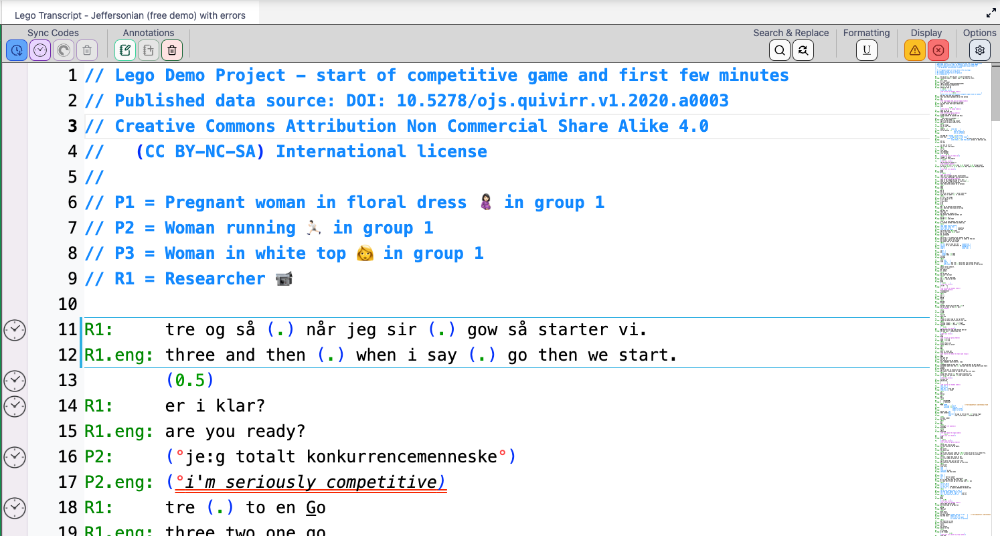{#fig:transskriptionseditor}

Øverst finder du forskellige grupperinger af funktioner:

- Sync codes – alt hvad der drejer sig om tid
  - Slå til/fra: DOTE synkronisere afspilning af transskriptionen med mediefilen.
  - Tilføj standard sync code på den linje din cursor er placeret på.
  - Tilføj ranged sync code – du skal have markeret et segment
  - Slet sync-code
- Annotations – kommentarer til transskription
  - Vis/skjul transcript-clips
  - Tilføj et transcript-clip
  - Slet et transcript-clip
- Search and replace
  - Søgfunktion
  - Erstatfunktion
- Formatering – det siger sig selv
  - Du kan lave understregninger af ord eller enkelte bogstaver
- Display – DOTE giver dig feedback på din transskription
  - Vis/skjul warnings i din transskription
  - Vis/sjul fejl i din transkription
- Options
  - Her kan du tilpasse indstillingerne for den enkelte transskription

## Start nyt projekt {.page_break_before}

For at komme i gang med at nyt projekt, så skal du vælge File → New project. Så åbner et vindue, hvor du skal angive hvor projektet skal gemmes på din computer (vælg et sted, som ikke er koblet med en cloud service (Onedrive, Icloud, dropbox, etc.). Så giver du dit nye projekt et navn og lad os også give transskriptionen et navn. Vi vælger Jefferson som standard.

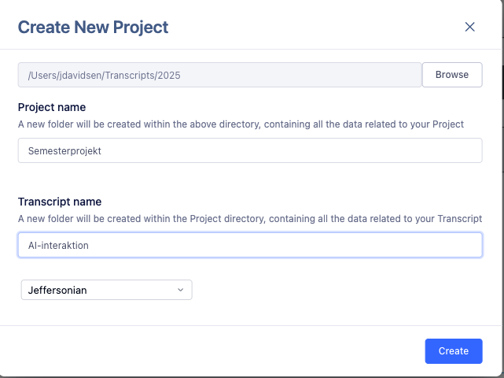{#fig:nyt-projekt}

### Importer mediefiler

Så har du lavet et projekt med en tilhørende transskription. Nu skal vi have tilknyttet de lyd- eller video-optagelser du skal arbejde med. I toppen af DOTE finder du ”Media Manager” – klik på den. Her kan du importere medie filer ind i dit projekt (obs. DOTE laver en kopi af din mediefil, så vær opmærksom på plads). Du trykker på Import Media Files og lokalisere den eller de filer du vil arbejde med. Afhængig af størrelsen på filen kan det tage lidt tid. Vær opmærksom på om der er flueben ud for den eller de filer du vil arbejde med.

{#fig:importer-mediefiler}

### Start ny transkription

#### Vælg Jefferson som standard

Jefferson, hva for noget! Du kan bruge DOTE uden nogen form for transskriptionskonvention – så skriver du bare løs. Men hvis du vil udnytte DOTEs fulde potentiale, så skal du i gang med Jefferson (eller Mondada). Vi fokuserer udelukkende på Jefferson her, hvis du vil prøve Mondadas konventioner så se vores tuturial om det online.

#### Metatekst

I toppen af transskriptionen I DOTE er det en god ide med lidt info. I DOTE skriver vi denne type info ved at bruge to // - så bliver teksten blå og DOTE ved at det er metatekst. Det er vigtigt, når vi skal eksportere vores transskription senere. Og det sådan set også fedt nok at vide hvad transskriptionen handler om – også hvis man skal sende ens transskription til andre I ens projektgruppe.

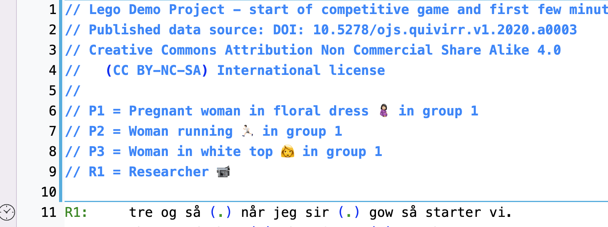{#fig:metatekst}

#### Initialer : tabs

For at DOTE kan hjælpe dig bedst muligt, så skal du simpelten følge denne struktur initialer: Tabs. Det ser sådan ud:

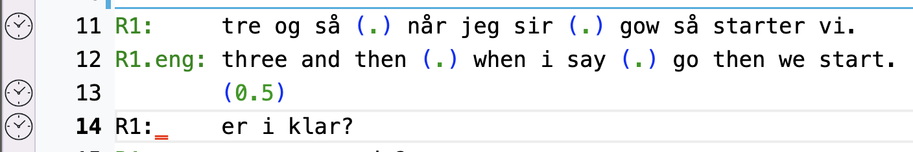{#fig:initialer-tabs}

Hvis ikke teksten bliver grøn, så har du lavet en fejl fx brugt space i stedet for tabs. Det går ikke → se linje 14.

#### Transkriber

Så er det bare med at komme i gang. DOTE tilføjer automatisk linjenumre til hver linje, så det skal du ikke tænke på. Du skal derimod bare skrive det du kan høre (og se) og følge Jeffersons konventioner. Jamen hovsa – DOTE kan hjælpe dig med at følge Jeffersons konventioner. Kan du fx huske genvejstasten til gradetegn? Nej, vel. DOTE kan hjælpe dig – bare skriv s – så kommer DOTE med et forslag.

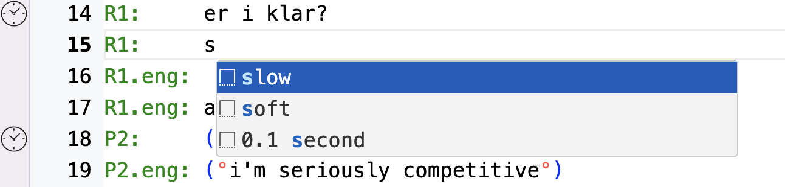{#fig:jefferson-forslag}

Så har du brugt det rigtige tegn til at vise at ord/sætninger bliver sagt hviskende eller lavt. DOTE hjælper dig med mange andre symboler og tegn, så du kan følge Jefferson.

## Importer {.page_break_before}

Du har modtaget en transskription fra en studiekammerat eller en AI. What to do?

## Eksporter

I DOTE kan du nemt eksportere dit arbejde.

### Eksporter projekt eller transkriptioner

### Eksporter transskriptioner til word

De fleste studerende arbejder med mindre udsnit af deres grov transskriptioner i deres projektrapporter. Derfor kan du med DOTE eksportere din transskription til rtf (en fil der kan læses af Word). Du kan vælge at eksportere hele din transskription eller specifikke dele. Lad os se hvordan.

## Tips og tricks {.page_break_before}

Her kommer en kort samling med mine bedste tips og tricks.

## Referencer {.page_break_before}

<!-- Explicitly insert bibliography here -->

